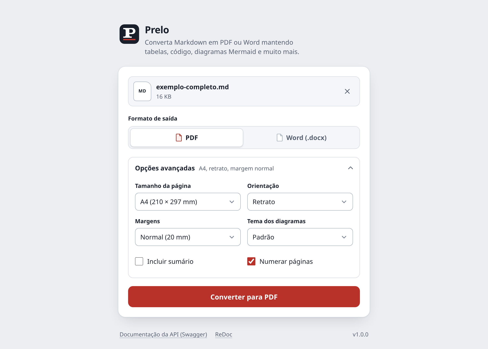
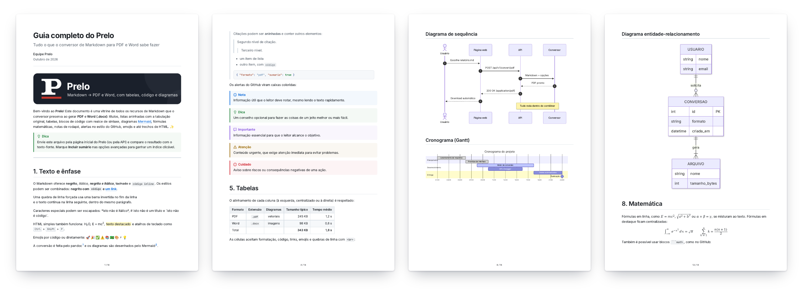
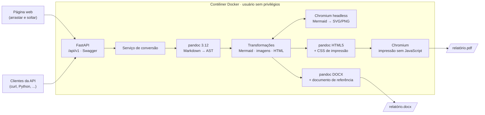

<h1 align="center">
  <picture>
    <source media="(prefers-color-scheme: dark)" srcset="docs/brand/logo-dark.svg">
    
  </picture>
</h1>

<p align="center">
  <strong>Markdown no prelo: PDF e Word sem perder a formatação.</strong><br>
  Tabelas, listas aninhadas, código com realce, diagramas Mermaid, fórmulas e muito mais —<br>
  pela página web ou por uma API REST documentada com Swagger, num único contêiner Docker.
</p>

<p align="center">
  <a href="https://github.com/taigorene/Prelo/actions/workflows/ci.yml"></a>
  <a href="https://github.com/taigorene/Prelo/actions/workflows/docker-publish.yml"></a>
  <a href="https://github.com/taigorene/Prelo/releases"></a>
  <a href="https://github.com/taigorene/Prelo/pkgs/container/prelo"></a>
  
  <a href="LICENSE"></a>
</p>

<p align="center">
  <a href="#início-rápido"><strong>Início rápido</strong></a> ·
  <a href="#usando-a-api"><strong>API</strong></a> ·
  <a href="#opções-de-conversão"><strong>Opções</strong></a> ·
  <a href="#configuração"><strong>Configuração</strong></a> ·
  <a href="#segurança"><strong>Segurança</strong></a> ·
  <a href="#english"><strong>English</strong></a>
</p>

> *prelo* (s.m.): prensa tipográfica — “estar no prelo” é estar prestes a ser publicado.



## Sumário

- [Recursos](#recursos)
- [Resultado](#resultado)
- [Início rápido](#início-rápido)
- [Como funciona](#como-funciona)
- [Usando a página web](#usando-a-página-web)
- [Usando a API](#usando-a-api)
- [Opções de conversão](#opções-de-conversão)
- [Markdown suportado](#markdown-suportado)
- [Configuração](#configuração)
- [Segurança](#segurança)
- [Desenvolvimento](#desenvolvimento)
- [Estrutura do projeto](#estrutura-do-projeto)
- [Limitações conhecidas](#limitações-conhecidas)
- [Contribuindo](#contribuindo)
- [Identidade visual](#identidade-visual)
- [Componentes de terceiros](#componentes-de-terceiros)
- [Licença](#licença)
- [English](#english)

## Recursos

- **Dois formatos de saída**: PDF (impresso pelo Chromium, com texto selecionável, links
  clicáveis e marcadores de navegação) e Word `.docx` (estilos nativos, editável).
- **Fidelidade ao GitHub**: o Markdown é lido com a sintaxe do GitHub (GFM), então o resultado
  corresponde ao que você vê no repositório.
- **Diagramas Mermaid**: fluxogramas, sequência, Gantt, classes, estados, pizza, ER e outros —
  vetoriais no PDF e em PNG de alta resolução no Word.
- **Formatação preservada**: listas aninhadas com a indentação original, tabelas com
  alinhamento, blocos de código com realce de sintaxe, tabulações, fórmulas (LaTeX), listas de
  tarefas, notas de rodapé, alertas do GitHub (`> [!NOTE]`), emojis, `<details>`, `<kbd>`,
  `<sup>`/`<sub>` e metadados YAML (título, autor, data).
- **Imagens**: por URL `https://`, embutidas (`data:`) ou locais — envie um `.zip` com o
  Markdown e a pasta de imagens.
- **Layout configurável**: tamanho da página (A4, Carta, Ofício, A3, A5), orientação, margens,
  sumário, numeração de páginas e tema dos diagramas.
- **Página web simples e responsiva**: arrastar e soltar, tema claro/escuro automático,
  funciona no celular.
- **API REST** com Swagger UI (`/docs`), ReDoc (`/redoc`) e OpenAPI (`/openapi.json`).
- **Seguro por padrão**: pandoc em modo sandbox, impressão sem JavaScript, proteção contra SSRF
  e *zip bombs*, contêiner sem privilégios. Nenhum documento é armazenado.
- **Pronto para usar**: imagem multi-arquitetura (`amd64` e `arm64`, inclusive Apple Silicon)
  publicada no GitHub Container Registry, com SBOM e atestado de procedência.

## Resultado

Páginas do PDF gerado a partir de [`examples/exemplo-completo.md`](examples/exemplo-completo.md)
— capa com metadados, alertas e tabelas, diagramas Mermaid e fórmulas:



## Início rápido

Requisito: [Docker](https://docs.docker.com/get-docker/). A imagem funciona em Linux, macOS
(Intel e Apple Silicon) e Windows (WSL 2).

### Com a imagem publicada

```bash
docker run -d --name prelo --restart unless-stopped \
  -p 127.0.0.1:8000:8000 --shm-size=512m \
  ghcr.io/taigorene/prelo:latest
```

Abra **<http://localhost:8000>** e arraste um arquivo `.md`. A documentação interativa da API
fica em **<http://localhost:8000/docs>**.

### Com Docker Compose (recomendado para servidores)

O [`docker-compose.yml`](docker-compose.yml) aplica as proteções extras descritas em
[Segurança](#segurança) — sandbox do Chromium, sistema de arquivos somente leitura, nenhuma
*capability* e limites de memória e de processos:

```bash
git clone https://github.com/taigorene/Prelo.git
cd Prelo
docker compose up -d            # baixa a imagem publicada
# docker compose up -d --build  # ou constrói a imagem a partir do código-fonte
```

> [!TIP]
> Para usar outra porta: `PRELO_PORT=9000 docker compose up -d`. Por padrão o serviço só
> atende no próprio computador (`127.0.0.1`); para abri-lo na rede local, use
> `PRELO_BIND=0.0.0.0` (veja [Segurança](#segurança)). A primeira build a partir do código
> baixa o pandoc, o Chromium e as fontes, por isso leva alguns minutos.

### Versões da imagem

| Tag | Conteúdo |
|-----|----------|
| `latest` | Último commit da branch `main` (testado em `amd64` e `arm64`) |
| `1.0.0`, `1.0`, `1` | Versões publicadas — fixe uma delas em produção |
| `sha-<commit>` | Um commit específico |

Cada imagem é publicada com SBOM e atestado de procedência; para conferir a origem:

```bash
gh attestation verify oci://ghcr.io/taigorene/prelo:latest -R taigorene/Prelo
```

### Primeiro teste

Converta o documento de exemplo, que usa todos os recursos:

```bash
curl -fL -o exemplo-completo.md \
  https://raw.githubusercontent.com/taigorene/Prelo/main/examples/exemplo-completo.md
curl -f -o exemplo.pdf -F "file=@exemplo-completo.md" -F "toc=true" \
  http://localhost:8000/api/v1/convert/pdf
```

Comandos úteis: `docker logs -f prelo` (logs) e `docker rm -f prelo` (parar); com Compose,
`docker compose logs -f` e `docker compose down`.

## Como funciona



1. O arquivo é validado (extensão, tamanho, codificação; `.zip` é extraído com limites).
2. O [pandoc](https://pandoc.org) converte o Markdown em uma árvore de documento (AST).
3. Os blocos ` ```mermaid ` são renderizados por um Chromium headless com o
   [Mermaid](https://mermaid.js.org) embutido; imagens são resolvidas e incorporadas.
4. **PDF**: o pandoc gera HTML com um CSS próprio para impressão e o Chromium imprime o PDF
   (com JavaScript desativado). **Word**: o pandoc gera o `.docx` a partir de um documento de
   referência com estilos cuidadosamente ajustados.

## Usando a página web

1. Arraste o arquivo para a área indicada (ou clique para escolher). São aceitos `.md`,
   `.markdown`, `.txt` e `.zip` (e arquivos de texto sem extensão, como `README`).
2. Escolha **PDF** ou **Word (.docx)**.
3. Se quiser, abra **Opções avançadas** para ajustar página, orientação, margens, tema dos
   diagramas, sumário e numeração de páginas. As escolhas ficam salvas no navegador.
4. Clique em **Converter**. O download começa automaticamente; se houver avisos (por exemplo,
   uma imagem não encontrada), eles aparecem logo abaixo.

**Imagens locais**: compacte a pasta do documento em um `.zip`. O arquivo principal é o único
Markdown do pacote ou, se houver vários, o `README.md`/`index.md` mais próximo da raiz.
Caminhos relativos (`imagens/foto.png`) partem da pasta do arquivo principal; caminhos que
começam com `/` partem da raiz do `.zip`.

```text
meu-projeto.zip
├── README.md            ← documento principal
└── imagens/
    └── arquitetura.png  ← 
```

## Usando a API

| Método | Caminho                          | Descrição                                          |
|--------|----------------------------------|----------------------------------------------------|
| POST   | `/api/v1/convert/{format}`       | Converte um arquivo enviado via `multipart/form-data` |
| POST   | `/api/v1/convert/{format}/text`  | Converte Markdown enviado em JSON                  |
| GET    | `/api/v1/health`                 | Saúde do serviço (200 ou 503; aceita também `HEAD`) |
| GET    | `/api/v1/info`                   | Versão, limites, opções e versões dos motores      |
| GET    | `/docs`                          | Swagger UI (teste as chamadas pelo navegador)      |
| GET    | `/redoc`                         | Documentação no formato ReDoc                      |
| GET    | `/openapi.json`                  | Especificação OpenAPI 3.1                          |

`{format}` é `pdf` ou `docx`.

### Enviando um arquivo

```bash
# PDF com as opções padrão (o nome do arquivo vem do cabeçalho Content-Disposition)
curl -f -OJ -F "file=@relatorio.md" http://localhost:8000/api/v1/convert/pdf

# Word em paisagem, com sumário e margens estreitas
curl -f -o relatorio.docx \
  -F "file=@relatorio.md" -F "orientation=landscape" -F "toc=true" -F "margin=narrow" \
  http://localhost:8000/api/v1/convert/docx

# Markdown + imagens locais em um .zip
(cd meu-projeto && zip -r ../meu-projeto.zip .)
curl -f -o meu-projeto.pdf -F "file=@meu-projeto.zip" http://localhost:8000/api/v1/convert/pdf
```

### Enviando o texto em JSON

```bash
curl -f -o ola.pdf -H "Content-Type: application/json" \
  -d '{"markdown": "# Olá\n\n| A | B |\n|---|---|\n| 1 | 2 |", "filename": "ola", "options": {"page_size": "A4", "toc": false}}' \
  http://localhost:8000/api/v1/convert/pdf/text
```

Campos do JSON: `markdown` (obrigatório), `filename` (nome do arquivo gerado, sem extensão;
padrão `documento`) e `options` (veja [Opções de conversão](#opções-de-conversão)).

### Python

```python
import json

import httpx

with open("relatorio.md", "rb") as arquivo:
    resposta = httpx.post(
        "http://localhost:8000/api/v1/convert/pdf",
        files={"file": ("relatorio.md", arquivo, "text/markdown")},
        data={"page_size": "A4", "toc": "true"},
        timeout=180,
    )
resposta.raise_for_status()

with open("relatorio.pdf", "wb") as saida:
    saida.write(resposta.content)

avisos = json.loads(resposta.headers["X-Conversion-Warnings"])
print(f"Convertido em {resposta.headers['X-Conversion-Time-Ms']} ms; avisos: {avisos}")
```

Com `requests` e o endpoint de texto:

```python
from pathlib import Path

import requests

resposta = requests.post(
    "http://localhost:8000/api/v1/convert/docx/text",
    json={"markdown": "# Ata da reunião\n\n- [x] Item aprovado", "filename": "ata"},
    timeout=180,
)
resposta.raise_for_status()
Path("ata.docx").write_bytes(resposta.content)
```

### Respostas

Em caso de sucesso, o corpo é o arquivo gerado (`application/pdf` ou
`application/vnd.openxmlformats-officedocument.wordprocessingml.document`) com os cabeçalhos:

| Cabeçalho                     | Conteúdo                                                           |
|-------------------------------|--------------------------------------------------------------------|
| `Content-Disposition`         | `attachment` com `filename` (ASCII) e `filename*` (UTF-8, para acentos) |
| `X-Conversion-Warnings`       | Lista JSON de avisos (ex.: imagem não encontrada, erro em diagrama); até 4 KB — se nem todos couberem, o último item diz quantos ficaram de fora |
| `X-Conversion-Warnings-Count` | Número total de avisos                                             |
| `X-Conversion-Time-Ms`        | Duração da conversão em milissegundos                              |

Avisos **não** impedem a conversão: um diagrama Mermaid inválido, por exemplo, é mantido como
bloco de código com uma mensagem de erro logo abaixo.

Erros retornam JSON no formato `{"detail": "mensagem", "code": "código"}`:

| HTTP | `code`               | Quando                                                     |
|------|----------------------|------------------------------------------------------------|
| 400  | `invalid_input`      | Arquivo vazio, binário ou `.zip` inválido/inseguro         |
| 400  | `bad_request`        | Corpo da requisição ilegível (ex.: `multipart` malformado) |
| 404  | `not_found`          | Caminho inexistente                                        |
| 405  | `method_not_allowed` | Método HTTP não aceito pelo caminho (veja o cabeçalho `Allow`) |
| 413  | `input_too_large`    | Arquivo (ou conteúdo do `.zip`) acima do limite, ou documento grande/complexo demais |
| 415  | `unsupported_file`   | Extensão não suportada                                     |
| 422  | `validation_error`   | Parâmetro inválido (detalhes em `errors`)                  |
| 500  | `internal_error`     | Erro inesperado                                            |
| 503  | `unavailable`        | Motor de conversão indisponível ou ocupado (tente de novo; veja `Retry-After`) |
| 504  | `timeout`            | A conversão excedeu o tempo limite                         |

## Opções de conversão

Enviadas como campos do formulário (`multipart`) ou no objeto `options` (JSON). Todas são
opcionais.

| Opção           | Valores                                              | Padrão    | Descrição                                   |
|-----------------|------------------------------------------------------|-----------|---------------------------------------------|
| `page_size`     | `A4`, `Letter` (Carta), `Legal` (Ofício), `A3`, `A5` | `A4`      | Tamanho da página                           |
| `orientation`   | `portrait` (retrato), `landscape` (paisagem)         | `portrait`| Orientação da página                        |
| `margin`        | `narrow` (12,7 mm), `normal` (20 mm), `wide` (30 mm) | `normal`  | Margens em todos os lados                   |
| `toc`           | `true`, `false`                                      | `false`   | Inclui um sumário no início                 |
| `page_numbers`  | `true`, `false`                                      | `true`    | Numera as páginas no rodapé                 |
| `mermaid_theme` | `default`, `neutral`, `dark`, `forest`               | `default` | Tema dos diagramas Mermaid                  |

## Markdown suportado

| Recurso                                   | PDF | Word | Observações                                         |
|-------------------------------------------|:---:|:----:|-----------------------------------------------------|
| Títulos, ênfase, tachado, links           | ✅  | ✅   | Links internos (`#secao`) funcionam no PDF          |
| Listas aninhadas e numeradas              | ✅  | ✅   | Indentação preservada, inclusive com código dentro  |
| Listas de tarefas (`- [x]`, `1. [ ]`)     | ✅  | ✅   | Também em listas numeradas, como no GitHub          |
| Tabelas com alinhamento e `<br>`          | ✅  | ✅   | Cabeçalho repetido em quebras de página. Uma tabela (ou fórmula) mais larga que a página é reduzida sozinha no PDF, sem diminuir o resto do documento; no Word, as colunas seguem o conteúdo e tabelas com muitas colunas usam fonte menor |
| Código com realce de sintaxe              | ✅  | ✅   | Linhas longas quebram sem perder a indentação (PDF) |
| Diagramas Mermaid                         | ✅  | ✅   | Vetor no PDF; PNG de alta resolução no Word         |
| Fórmulas (`$...$`, `$$...$$`, ` ```math `)| ✅  | ✅   | MathML no PDF; equações nativas no Word             |
| Notas de rodapé                           | ✅  | ✅   |                                                     |
| Citações e alertas do GitHub (`> [!NOTE]` etc.) | ✅  | ✅   | Caixas coloridas (no Word, uma caixa que mantém listas, código e citações aninhadas dentro dela). Títulos em português (Nota, Dica...) quando o documento tem `lang: pt-BR` |
| Emojis (`:rocket:` e Unicode)             | ✅  | ✅   | No Word, dependem da fonte de emoji do sistema      |
| Imagens (URL, `data:`, `.zip`)            | ✅  | ✅   | SVG/WebP são convertidos para PNG no Word           |
| HTML simples (`<details>`, `<kbd>`, `<sup>`, `<sub>`, ``, `<br>`, `<pre>`, `align="center"`) | ✅ | ✅ | `<details>` aparece sempre aberto no PDF; no Word, `align="center"`/`"right"` e `<pre>` (como bloco de código) são mantidos |
| Metadados YAML (`title`, `author`, `date`, `lang`) | ✅ | ✅ | Viram o bloco de título do documento. Um cabeçalho YAML inválido (ex.: `title: Parte 1: Introdução`, sem aspas) é convertido como texto comum, com um aviso |
| Quebra de página manual (`<div class="page-break"></div>`) | ✅ | — | Força o conteúdo seguinte para uma nova página no PDF |

O arquivo [`examples/exemplo-completo.md`](examples/exemplo-completo.md) demonstra todos esses
recursos.

## Configuração

O serviço é configurado por variáveis de ambiente com o prefixo `PRELO_`. O
`docker-compose.yml` já repassa as mais comuns; para as demais, adicione-as em `environment:`
(por exemplo, em um `docker-compose.override.yml`).

| Variável                        | Padrão    | Descrição                                                         |
|---------------------------------|-----------|-------------------------------------------------------------------|
| `PRELO_PORT`                    | `8000`    | Porta publicada no host (somente `docker compose`)                |
| `PRELO_BIND`                    | `127.0.0.1` | Interface do host onde a porta é publicada (somente `docker compose`); `0.0.0.0` abre para a rede |
| `PRELO_MEMORY_LIMIT`            | `6g`      | Limite de memória do contêiner (somente `docker compose`): cerca de 1,2 GB por conversão simultânea + 1 GB. Em máquinas menores, reduza também `PRELO_MAX_CONCURRENT_JOBS` |
| `PRELO_MAX_UPLOAD_MB`           | `20`      | Tamanho máximo do arquivo enviado (MB)                            |
| `PRELO_MAX_CONCURRENT_JOBS`     | `4`       | Conversões simultâneas; as demais aguardam na fila                |
| `PRELO_CONVERSION_TIMEOUT`      | `120`     | Tempo máximo de cada conversão (segundos)                         |
| `PRELO_ZIP_MAX_FILES`           | `1000`    | Número máximo de entradas em um `.zip`                            |
| `PRELO_ZIP_MAX_UNCOMPRESSED_MB` | `200`     | Tamanho máximo do `.zip` depois de extraído (MB)                  |
| `PRELO_ALLOW_REMOTE_IMAGES`     | `true`    | Baixa imagens referenciadas por URL                               |
| `PRELO_ALLOW_PRIVATE_NETWORKS`  | `false`   | Permite baixar de endereços privados/locais (cuidado: SSRF)       |
| `PRELO_REMOTE_IMAGE_MAX_MB`     | `10`      | Tamanho máximo de cada imagem (remota ou do `.zip`) (MB)          |
| `PRELO_REMOTE_TIMEOUT`          | `10`      | Tempo limite de cada download (segundos)                          |
| `PRELO_MAX_REMOTE_IMAGES`       | `50`      | Número máximo de imagens remotas por documento                    |
| `PRELO_MAX_IMAGES_TOTAL_MB`     | `50`      | Tamanho somado de todas as imagens (e outros arquivos) de um documento (MB) |
| `PRELO_CHROMIUM_SANDBOX`        | `auto`    | Sandbox do Chromium: `auto` (usa quando o contêiner permite), `true` (obrigatório) ou `false` |
| `PRELO_CORS_ORIGINS`            | `*`       | Origens permitidas (CORS), separadas por vírgula                  |
| `PRELO_ROOT_PATH`               | *(vazio)* | Prefixo de caminho quando publicado atrás de um proxy (ex.: `/prelo`) |
| `PRELO_LOG_LEVEL`               | `info`    | Nível de log da aplicação (`debug`, `info`, `warning`, `error`); o `docker compose` também o aplica ao uvicorn |
| `PRELO_TRUSTED_PROXIES`         | `127.0.0.1,::1` | Proxies cujos cabeçalhos `X-Forwarded-*` são aceitos (somente `docker compose`; fora dele, `FORWARDED_ALLOW_IPS`) |
| `PRELO_PANDOC_PATH`             | `pandoc`  | Executável do pandoc                                              |
| `PRELO_VENDOR_DIR`              | `vendor`  | Pasta com Mermaid, Swagger UI e ReDoc (na imagem: `/opt/prelo/vendor`) |
| `PRELO_REFERENCE_DOCX`          | *(vazio)* | Documento de referência do Word; gerado automaticamente se ausente (na imagem: `/opt/prelo/reference.docx`) |

Os documentos nunca são gravados de forma permanente: cada conversão usa uma pasta temporária
apagada ao final, e os logs registram apenas formato, tamanhos, número de avisos e duração.

O uvicorn lê as próprias variáveis: `UVICORN_LOG_LEVEL` (nível dos logs do servidor),
`UVICORN_ACCESS_LOG=false` (sem uma linha por requisição, inclusive o *health check* a cada
30 s), `FORWARDED_ALLOW_IPS` e `UVICORN_TIMEOUT_GRACEFUL_SHUTDOWN` (padrão `125`: ao parar o
contêiner, conversões em andamento têm esse tempo para terminar; o `docker-compose.yml` espera
135 s antes de encerrar à força — com `docker run`, use `--stop-timeout 135`).

> [!NOTE]
> No `docker-compose.override.yml`, a lista `ports:` é **somada** à do arquivo principal. Para
> trocar a porta publicada, use `ports: !override` (ou apenas `PRELO_BIND`/`PRELO_PORT`).

## Segurança

O Prelo processa arquivos enviados por terceiros, então foi construído com várias camadas de
proteção:

- **pandoc em modo `--sandbox`**: o conversor não lê arquivos do servidor; imagens só entram no
  documento depois de validadas.
- **Impressão sem JavaScript**: o HTML do PDF é renderizado com JavaScript desativado e toda
  requisição de rede passa por um filtro — apenas imagens, fontes e mídia validadas; `file://`,
  iframes, scripts e navegações são bloqueados.
- **Mermaid isolado**: os diagramas são renderizados em uma página sem acesso à rede
  (`securityLevel: strict`, Content-Security-Policy própria e WebSockets bloqueados).
- **Chromium sem rede própria e com sandbox**: tudo o que o navegador carrega passa pelo filtro
  de requisições; o resto (WebSockets, conexões antecipadas) vai para uma porta local fechada.
  O sandbox do Chromium é usado sempre que o contêiner permite (veja abaixo).
- **Proteção contra SSRF**: imagens remotas são baixadas apenas de endereços públicos (cada
  redirecionamento é revalidado), com limite de tamanho, quantidade e tempo. Desative de vez com
  `PRELO_ALLOW_REMOTE_IMAGES=false`.
- **`.zip` seguro**: limites de entradas e de tamanho extraído; caminhos absolutos, `..`,
  links simbólicos e arquivos criptografados são rejeitados.
- **Limites de recursos**: tamanho de upload (também do Markdown dentro do `.zip`), tempo por
  conversão, conversões simultâneas e fila de espera limitada; tamanho somado das imagens de
  cada documento, tamanho em pixels de cada imagem (contra "bombas" de descompressão) e memória
  do pandoc. Uma imagem usada muitas vezes é incorporada uma vez só, e conversões cujo cliente
  desconectou são canceladas.
- **Contêiner sem privilégios**: processo com usuário não-root (`uid 10001`), `tini` como
  init e, no `docker-compose.yml`, `no-new-privileges`, nenhuma *capability*
  (`cap_drop: ALL`), sistema de arquivos somente leitura (exceto `/tmp`, em memória) e limites
  de memória e de processos.
- **Cabeçalhos de segurança**: `Content-Security-Policy` restritiva na página web,
  `X-Content-Type-Options`, `Referrer-Policy` e proteção contra *framing*.

**Sandbox do Chromium**: o `docker-compose.yml` usa o perfil seccomp
[`seccomp-chromium.json`](seccomp-chromium.json) — o perfil padrão do Docker com `clone`,
`unshare` e `chroot` liberados — para que o Chromium crie o próprio sandbox mesmo sem nenhuma
*capability*. O log informa `Chromium ... started (sandbox on)`. Sem o perfil (por exemplo, em
um `docker run` simples), ou em hosts que bloqueiam *user namespaces* (Ubuntu 23.10+ com
AppArmor restritivo), o Prelo roda sem o sandbox e registra um aviso; use
`PRELO_CHROMIUM_SANDBOX=true` para exigir o sandbox ou `false` para dispensá-lo.

> [!IMPORTANT]
> A API não tem autenticação nem limite de requisições por cliente. Para expor o serviço na
> internet, publique-o atrás de um proxy reverso (nginx, Caddy, Traefik...) com HTTPS,
> autenticação e *rate limiting*, e ajuste `PRELO_CORS_ORIGINS` para o seu domínio. O
> contêiner deve escutar só em `127.0.0.1` (o padrão do `docker-compose.yml`): portas
> publicadas pelo Docker ignoram firewalls do host como ufw e firewalld, então uma porta aberta
> em `0.0.0.0` permitiria contornar o proxy.

Exemplo mínimo com nginx (no mesmo host):

```nginx
limit_req_zone $binary_remote_addr zone=prelo:10m rate=30r/m;

server {
    listen 443 ssl;
    server_name docs.exemplo.com.br;
    client_max_body_size 25m;

    location / {
        auth_basic "Prelo";
        auth_basic_user_file /etc/nginx/prelo.htpasswd;
        limit_req zone=prelo burst=10 nodelay;
        proxy_pass http://127.0.0.1:8000;
        proxy_read_timeout 180s;
        proxy_set_header Host $host;
        proxy_set_header X-Forwarded-For $proxy_add_x_forwarded_for;
        proxy_set_header X-Forwarded-Proto $scheme;
    }
}
```

Para que os logs mostrem o IP real dos clientes, informe em `PRELO_TRUSTED_PROXIES` o endereço
do proxy **como o contêiner o vê** — para um nginx no próprio host, o gateway da rede do Docker
(por exemplo, `172.16.0.0/12`). Cabeçalhos `X-Forwarded-*` de qualquer outro endereço são
ignorados.

## Desenvolvimento

### Testes (no Docker)

A suíte usa `pytest` e roda dentro do estágio `test` da imagem, com pandoc e Chromium reais:

```bash
make test
# equivalente a:
docker build --target test -t prelo:test .
docker run --rm --init prelo:test
```

Os testes cobrem os endpoints, a documentação OpenAPI, a página web, conversões PDF e Word
(conteúdo, tabelas, imagens, estilos, orientação, rodapé, alinhamento e largura de elementos),
codificações de texto, arquivos `.zip`, limites (tamanho, imagens, pixels, memória, fila),
diagramas Mermaid inválidos, conversões simultâneas e canceladas e cenários de segurança
(leitura de arquivos locais, SSRF, rede do navegador e HTML malicioso).

### Comandos do `make`

| Comando      | O que faz                                                             |
|--------------|-----------------------------------------------------------------------|
| `make build` | Constrói a imagem de produção (`prelo:latest`)                        |
| `make up`    | Sobe o serviço com `docker compose` em <http://localhost:8000>        |
| `make down`  | Para e remove o contêiner                                             |
| `make logs`  | Acompanha os logs                                                     |
| `make test`  | Constrói o estágio `test` e roda a suíte de testes                    |
| `make vendor`| Baixa Mermaid, Swagger UI e ReDoc para `./vendor` (para rodar sem Docker) |
| `make lock`  | Regera `requirements*.txt` (versões e hashes) a partir de `requirements*.in` |
| `make dev`   | Roda localmente com recarga automática (`uvicorn --reload`)           |
| `make clean` | Remove contêineres, imagens locais do projeto e caches                |

### Rodando sem Docker

Requisitos: Python 3.13, [pandoc 3.12](https://github.com/jgm/pandoc/releases/tag/3.12),
`curl` e `sha256sum` (para `make vendor`).

```bash
python -m venv .venv && source .venv/bin/activate
pip install -r requirements.txt -r requirements-dev.txt
playwright install chromium        # navegador headless usado pelo conversor
make vendor                        # Mermaid, Swagger UI e ReDoc em ./vendor
make dev                           # http://localhost:8000 com recarga automática
python -m pytest -q                # testes
```

Variáveis de ambiente também podem ser definidas em um arquivo `.env` na raiz do projeto. Os
PDFs gerados localmente usam as fontes instaladas no seu sistema; a imagem Docker já inclui
Inter, JetBrains Mono, DejaVu e Noto (com emojis).

### Dependências

As dependências Python diretas ficam em `requirements.in` (aplicação) e `requirements-dev.in`
(testes). Os arquivos `requirements.txt` e `requirements-dev.txt` são gerados a partir deles,
com **todas** as dependências fixadas e com hashes (a imagem instala com `--require-hashes`):
depois de editar um `.in`, rode `make lock`. A imagem base também é fixada por *digest*; o
[Dependabot](.github/dependabot.yml) propõe atualizações semanais de pacotes, imagem e
*actions* — inclusive do Playwright, o único caminho para correções de segurança do Chromium.

### Integração contínua e publicação

- [`ci.yml`](.github/workflows/ci.yml) — a cada push e pull request para `main`: *lint*
  (ruff), suíte de testes no estágio `test`, imagem de produção, contêiner com as mesmas
  restrições do `docker-compose.yml` e conversão do documento de exemplo para PDF e Word pela
  API.
- [`docker-publish.yml`](.github/workflows/docker-publish.yml) — a cada push para `main` e a
  cada tag `v*.*.*`: constrói a imagem nativamente em `amd64` e `arm64` (rodando a suíte de
  testes completa em cada arquitetura), publica a imagem multi-arquitetura em
  `ghcr.io/taigorene/prelo` com SBOM e atestado de procedência, testa a imagem publicada e,
  para tags, cria o *release* no GitHub.

Para publicar uma versão: atualize `__version__` em `app/__init__.py` e crie a tag
correspondente (`git tag v1.2.0 && git push origin v1.2.0`).

## Estrutura do projeto

```text
Prelo/
├── .github/                  # CI, publicação da imagem e Dependabot
├── app/
│   ├── main.py               # criação da aplicação, middlewares, Swagger/ReDoc, página web
│   ├── config.py             # configurações (variáveis PRELO_*)
│   ├── api/                  # rotas, esquemas e tratamento de erros da API
│   ├── converter/            # motor de conversão
│   │   ├── service.py        # orquestração (fila, timeout, pasta temporária)
│   │   ├── inputs.py         # validação, codificação e extração de .zip
│   │   ├── pandoc.py         # chamadas ao pandoc (sandbox)
│   │   ├── ast.py            # transformações na árvore do documento
│   │   ├── mermaid.py        # renderização dos diagramas
│   │   ├── resources.py      # imagens locais, remotas e data URIs (proteção SSRF)
│   │   ├── browser.py        # ciclo de vida do Chromium
│   │   ├── html.py, pdf.py   # montagem do HTML e impressão do PDF
│   │   ├── docx.py           # documento Word por conversão (página, rodapé)
│   │   ├── docx_reference.py # estilos do documento de referência do Word
│   │   └── assets/           # template HTML, CSS de impressão, filtros Lua
│   └── static/               # página web (HTML, CSS e JavaScript, sem build), ícones e manifesto
├── docs/                     # imagens do README; brand/ tem logotipo e imagem de compartilhamento
├── examples/                 # documento de exemplo com todos os recursos
├── scripts/
│   ├── fetch_vendor.sh       # download verificado (SHA-256) de Mermaid, Swagger UI e ReDoc
│   └── lock_requirements.sh  # gera requirements*.txt (com hashes) a partir de requirements*.in
├── tests/                    # suíte de testes (pytest)
├── Dockerfile                # estágios base, app, test e runtime
├── docker-compose.yml
├── seccomp-chromium.json     # perfil seccomp que permite o sandbox do Chromium
└── Makefile
```

## Limitações conhecidas

- **Diagramas**: apenas Mermaid. PlantUML, Graphviz e similares não são renderizados (o código
  aparece como bloco de código).
- **Sumário no Word**: o sumário é um campo do Word e aparece vazio até ser atualizado. No
  Word, clique com o botão direito sobre ele e escolha **Atualizar campo** (ou pressione
  <kbd>F9</kbd>); no LibreOffice, use **Ferramentas → Atualizar → Atualizar tudo**.
- **Fontes**: o PDF já sai com as fontes incorporadas. O `.docx` usa Calibri e Consolas,
  exibidas com as fontes do computador de quem abrir o arquivo (o LibreOffice usa equivalentes
  métricos, como Carlito). Sem a Consolas instalada (por exemplo, LibreOffice no Linux), o
  código aparece em uma fonte proporcional e o alinhamento das colunas pode variar.
- **Fórmulas no Word**: são equações nativas do Word. O LibreOffice não interpreta alguns
  recursos delas (alinhamento de `aligned`, chaves de `cases`); no Word aparecem corretas.
- **HTML embutido**: elementos simples são suportados; scripts, formulários, iframes e CSS
  complexo são ignorados. No Word, apenas HTML que tenha equivalente no formato é convertido.
- **Diagramas no Word** são imagens (PNG), não objetos editáveis.
- **Imagens remotas** exigem acesso à internet a partir do contêiner; endereços de redes
  privadas são bloqueados por padrão.
- **Arquivos muito grandes** ou com muitos diagramas podem exceder o tempo limite; ajuste
  `PRELO_CONVERSION_TIMEOUT` se necessário. Documentos extremamente densos (vários MB de
  Markdown) podem ser recusados como grandes/complexos demais (HTTP 413), para proteger a
  memória do servidor.
- **Imagens**: cada documento pode incorporar até `PRELO_MAX_IMAGES_TOTAL_MB` (50 MB) de
  imagens, até 2.000 imagens e até 200 megapixels no total (50 por imagem); o que passar disso
  vira texto alternativo, com um aviso.

## Contribuindo

Sugestões, relatos de bugs e *pull requests* são bem-vindos — abra uma
[issue](https://github.com/taigorene/Prelo/issues) descrevendo o caso (de preferência com um
trecho de Markdown que reproduza o problema). Antes de enviar um PR, rode `make test` e
verifique o estilo com `ruff check app tests && ruff format --check app tests`. Para falhas de
segurança, não abra uma issue pública: use
[*Report a vulnerability*](https://github.com/taigorene/Prelo/security/advisories/new).

## Identidade visual

O símbolo do Prelo é um **P** de tipo de madeira, com serifas egípcias, logo acima de um fio
vermelho que representa a folha de papel. O respiro entre os dois é o instante antes da
impressão — o texto “no prelo”. O fio também é o `---` que, no Markdown, transforma a linha de
cima em título. O nome é composto em Inter Bold e convertido em curvas, então o logotipo aparece
igual em qualquer lugar, sem depender de fontes instaladas.

| Arquivo | Uso |
|---------|-----|
| `docs/brand/logo-light.svg`, `docs/brand/logo-dark.svg` | Assinatura (símbolo + nome) para fundos claros e escuros |
| `app/static/brand/icon.svg` | Símbolo com fundo: avatar, atalhos, apresentações |
| `app/static/favicon.svg`, `favicon-32.png`, `favicon.ico` | Favicon (SVG, com PNG e ICO para navegadores antigos) |
| `app/static/brand/icon-glyph.svg` | Símbolo em uma cor só (`currentColor`), para fundos coloridos e impressão |
| `app/static/brand/*.png`, `app/static/site.webmanifest` | Ícones do app (iOS, Android, instalação como PWA) |
| `docs/brand/social-preview.png` | Imagem de compartilhamento do repositório (1280 × 640) |

- Use sempre o P junto com o fio: sem ele, o símbolo vira uma letra qualquer num quadrado.
- Sobre fundos vermelhos ou azuis, use o glifo de uma cor só (o fio vermelho desaparece no
  vermelho). Tamanho mínimo: 16 px para o símbolo e 20 px de altura para a assinatura.
- Na página web, o fio acompanha o formato escolhido: vermelho para PDF e azul para Word.

## Componentes de terceiros

A imagem Docker inclui: [pandoc](https://pandoc.org) (GPL-2.0-or-later),
[Chromium](https://www.chromium.org) via [Playwright](https://playwright.dev) (BSD-3-Clause /
Apache-2.0), [Mermaid](https://mermaid.js.org) (MIT), [Swagger UI](https://swagger.io/tools/swagger-ui/)
(Apache-2.0), [ReDoc](https://github.com/Redocly/redoc) (MIT), [FastAPI](https://fastapi.tiangolo.com) (MIT) e as fontes Inter, JetBrains Mono e
Noto (SIL OFL 1.1) e DejaVu (licença livre própria). Cada componente mantém a sua licença.

## Licença

Distribuído sob a licença [MIT](LICENSE). Copyright (c) 2026 Taigo.

---

## English

**Prelo** (Portuguese for “printing press”) converts Markdown to **PDF** and **Word (.docx)**
while preserving formatting: GitHub-flavored Markdown, nested lists, tables, syntax-highlighted
code, **Mermaid diagrams**, math, footnotes, GitHub alerts, emoji, images (URLs, data URIs or a
`.zip` with local files) and simple raw HTML. It ships as a single Docker container with a
responsive drag-and-drop web page and a REST API documented with Swagger UI.

```bash
# multi-arch image (amd64/arm64), then open http://localhost:8000 (web) or /docs (Swagger)
docker run -d --name prelo -p 127.0.0.1:8000:8000 --shm-size=512m ghcr.io/taigorene/prelo:latest

curl -f -o doc.pdf -F "file=@README.md" http://localhost:8000/api/v1/convert/pdf
curl -f -o doc.docx -H "Content-Type: application/json" \
  -d '{"markdown": "# Hello\n\nSome **bold** text."}' http://localhost:8000/api/v1/convert/docx/text
```

- API docs: `/docs` (Swagger UI), `/redoc`, `/openapi.json`.
- Options: `page_size`, `orientation`, `margin`, `toc`, `page_numbers`, `mermaid_theme`.
- Configuration: `PRELO_*` environment variables (see [Configuração](#configuração)).
- Tests: `make test` (runs pytest inside the Docker `test` stage). Contributions are welcome via
  issues and pull requests.
- Docker image: `ghcr.io/taigorene/prelo` — `latest` (main), `1.0.0`/`1.0`/`1` (releases) and
  `sha-<commit>`, for `linux/amd64` and `linux/arm64`, with SBOM and build provenance
  (`gh attestation verify oci://ghcr.io/taigorene/prelo:latest -R taigorene/Prelo`).
- Hardened deployment: `git clone https://github.com/taigorene/Prelo.git && cd Prelo && docker
  compose up -d` (Chromium sandbox, read-only filesystem, no capabilities, memory limits).
- Security: sandboxed pandoc, JavaScript-free PDF rendering, Chromium's own sandbox (with the
  bundled seccomp profile), SSRF protection, per-document image/memory limits, zip limits and
  a non-root, read-only container without capabilities. Compose publishes the port on
  `127.0.0.1` only. There is no authentication: put it behind a reverse proxy with auth and
  rate limiting before exposing it publicly.

The user interface, API messages and documentation are in Brazilian Portuguese. Licensed under
the [MIT License](LICENSE).
