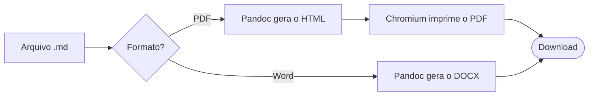
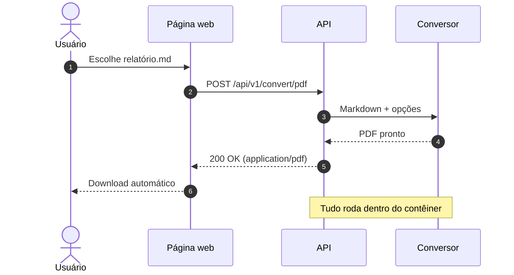
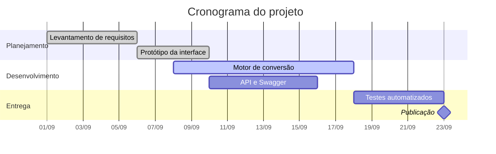
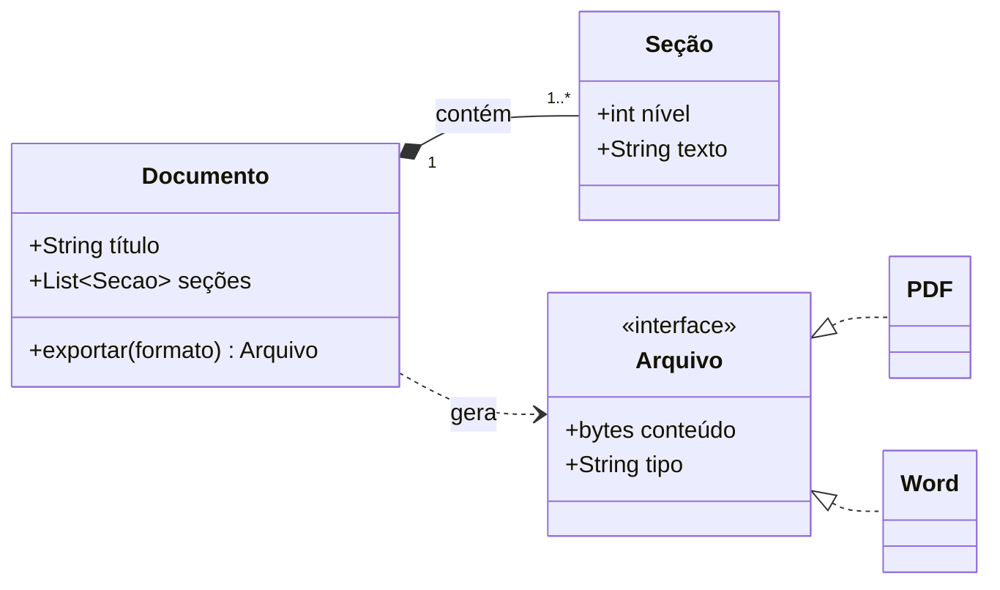
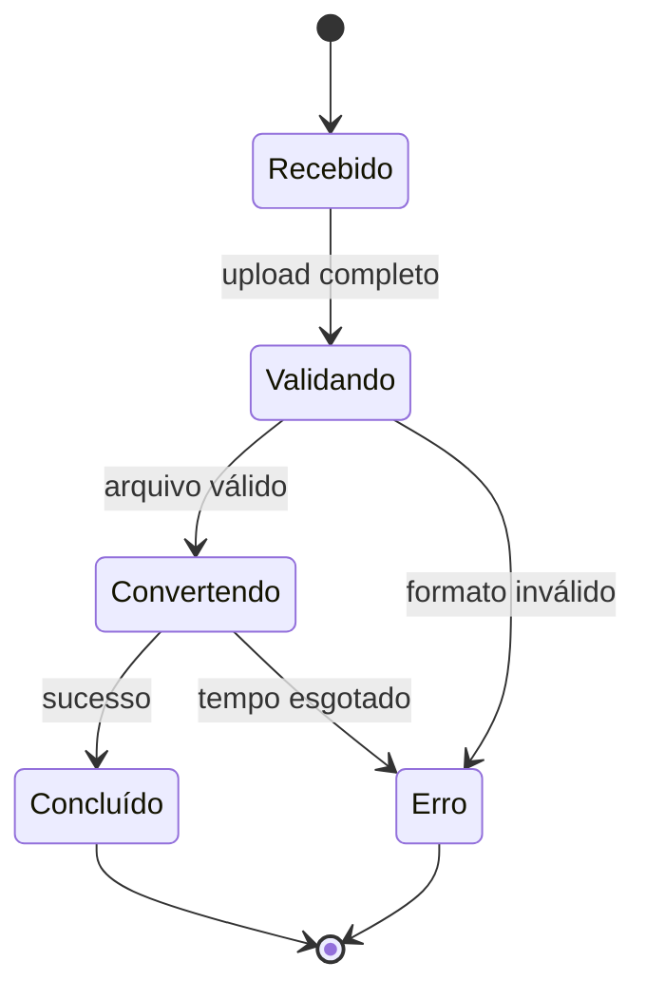
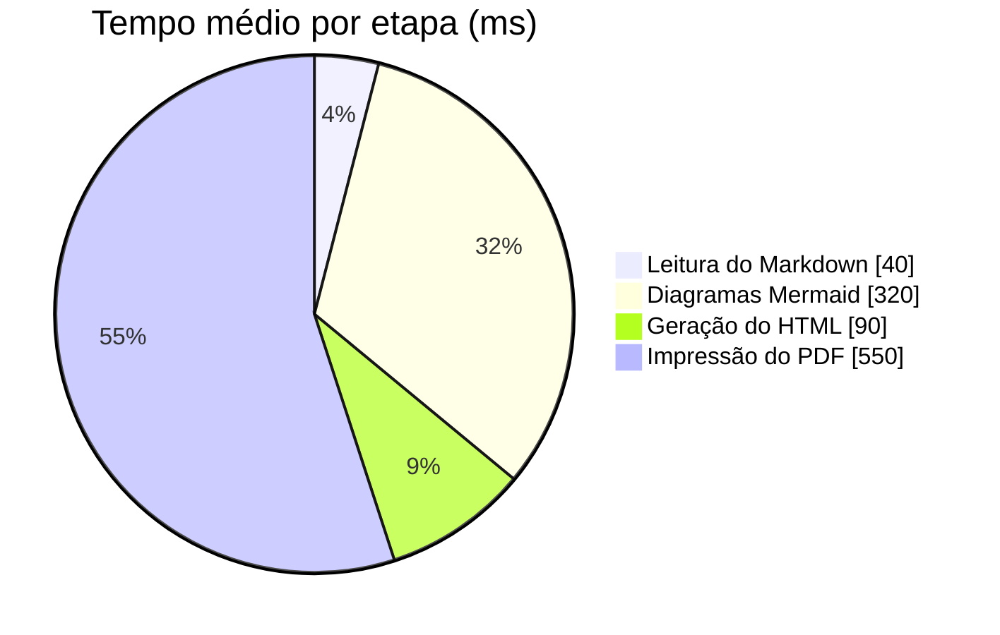
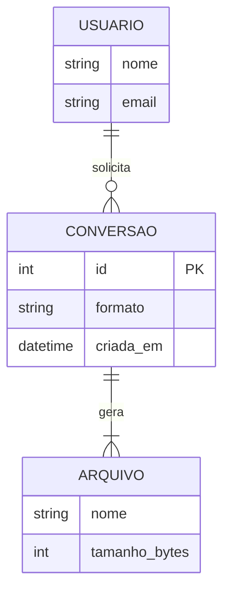

![Banner do Prelo][banner]

Bem-vindo ao **Prelo**! Este documento é uma vitrine de *todos* os recursos de Markdown que o
conversor preserva ao gerar **PDF** e **Word (.docx)**: títulos, listas aninhadas com a tabulação
original, tabelas, blocos de código com realce de sintaxe, diagramas [Mermaid][mermaid], fórmulas
matemáticas, notas de rodapé, alertas no estilo do GitHub, emojis e até trechos de HTML. :sparkles:

> [!TIP]
> Envie este arquivo pela página inicial do Prelo (ou pela API) e compare o resultado com o
> texto-fonte. Marque **Incluir sumário** nas opções avançadas para ganhar um índice clicável.

---

# 1. Texto e ênfase

O Markdown oferece **negrito**, *itálico*, ***negrito e itálico***, ~~tachado~~ e `código inline`.
Os estilos podem ser combinados: **negrito com `código` e [um link](https://pandoc.org)**.

Uma quebra de linha forçada usa uma barra invertida no fim da linha\
e o texto continua na linha seguinte, dentro do mesmo parágrafo.

Caracteres especiais podem ser escapados: \*isto não é itálico\*, \# isto não é um título e
\`isto não é código\`.

HTML simples também funciona: H<sub>2</sub>O, E = mc<sup>2</sup>, <mark>texto destacado</mark> e
atalhos de teclado como <kbd>Ctrl</kbd> + <kbd>Shift</kbd> + <kbd>P</kbd>.

Emojis por código ou diretamente: :rocket: :tada: :white_check_mark: :warning: :books: :brazil: 🎨 ⚡ 💡

A conversão é feita pelo pandoc[^pandoc] e os diagramas são desenhados pelo Mermaid[^mermaid].

## Links

- Link em linha: [manual do pandoc](https://pandoc.org/MANUAL.html)
- Link por referência: [Mermaid][mermaid] e [GitHub Flavored Markdown][gfm]
- URL automática: <https://commonmark.org> e também https://www.markdownguide.org
- Link interno: [ir para os diagramas](#7-diagramas-mermaid) ou [para a matemática](#8-matemática)
- E-mail: <contato@exemplo.com.br>

# 2. Títulos

Os seis níveis de título são preservados, cada um com seu próprio estilo.

## Título de nível 2

### Título de nível 3

#### Título de nível 4

##### Título de nível 5

###### Título de nível 6

# 3. Listas e tabulação

A indentação das listas é mantida em todos os níveis — inclusive quando um item contém vários
parágrafos, citações ou blocos de código.

## Lista não ordenada

- Planejamento
  - Definir o objetivo do documento
  - Reunir as referências
    - Artigos e manuais
    - Exemplos de código
      - Um quarto nível, para quem gosta de detalhes
- Escrita
  - Rascunho
  - Revisão
- Publicação

## Lista ordenada e mista

1. Instale o Docker.
2. Suba o serviço:

   ```bash
   docker compose up -d --build
   ```

3. Abra o navegador em `http://localhost:8000` e:
   1. arraste o arquivo `.md` para a área indicada;
   2. escolha **PDF** ou **Word**;
      - ajuste as opções avançadas, se quiser;
      - clique em **Converter**.
   3. pronto: o download começa sozinho.

   > Itens de lista também podem conter citações e vários parágrafos.

4. Compartilhe o resultado. :outbox_tray:

Listas numeradas podem começar em qualquer número:

7. sétimo item
8. oitavo item
9. nono item

## Lista de tarefas

- [x] Converter Markdown em PDF
- [x] Converter Markdown em Word
- [x] Renderizar diagramas Mermaid
- [ ] Dominar o mundo
  - [x] Escrever a documentação
  - [ ] Tomar um café ☕

# 4. Citações e alertas

> “A simplicidade é o último grau de sofisticação.”
>
> — Leonardo da Vinci

> Citações podem ser **aninhadas** e conter outros elementos:
>
> > Segundo nível de citação.
> >
> > > Terceiro nível.
>
> - um item de lista
> - outro item, com `código`
>
> ```json
> { "formato": "pdf", "sumario": true }
> ```

Os alertas do GitHub viram caixas coloridas:

> [!NOTE]
> Informação útil que o leitor deve notar, mesmo lendo o texto rapidamente.

> [!TIP]
> Um conselho opcional para fazer as coisas de um jeito melhor ou mais fácil.

> [!IMPORTANT]
> Informação essencial para que o leitor alcance o objetivo.

> [!WARNING]
> Conteúdo urgente, que exige atenção imediata para evitar problemas.

> [!CAUTION]
> Aviso sobre riscos ou consequências negativas de uma ação.

# 5. Tabelas

O alinhamento de cada coluna (à esquerda, centralizado ou à direita) é respeitado:

| Formato | Extensão | Diagramas | Tamanho típico | Tempo médio |
|:--------|:--------:|:---------:|---------------:|------------:|
| PDF     | `.pdf`   | vetoriais |         245 KB |       1,2 s |
| Word    | `.docx`  | imagens   |          98 KB |       0,6 s |
| Total   |          |           |     **343 KB** |   **1,8 s** |

As células aceitam formatação, código, links, emojis e quebras de linha com `<br>`:

| Recurso         | Sintaxe                          | Resultado                        |
|-----------------|----------------------------------|----------------------------------|
| Quebra de linha | `linha 1<br>linha 2`             | linha 1<br>linha 2               |
| Código inline   | `` `print("olá")` ``             | `print("olá")`                   |
| Barra vertical  | `a \| b`                         | a \| b                           |
| Link            | `[pandoc](https://pandoc.org)`   | [pandoc](https://pandoc.org)     |
| Emoji           | `:tada:`                         | :tada:                           |
| Teclas          | `<kbd>Ctrl</kbd>+<kbd>S</kbd>`   | <kbd>Ctrl</kbd>+<kbd>S</kbd>     |

Tabelas largas quebram o texto automaticamente para caber na página:

| ID | Cliente     | Cidade         | Produto                 | Qtd. | Valor unitário | Status | Observações                                  |
|---:|-------------|----------------|-------------------------|-----:|---------------:|:------:|----------------------------------------------|
|  1 | Ana Beatriz | São Paulo      | Notebook ultrafino 14"  |    2 |    R$ 6.499,00 |   ✅   | Entrega expressa solicitada pelo cliente     |
|  2 | João Pedro  | Florianópolis  | Monitor 27" 4K          |    1 |    R$ 2.899,90 |   ⏳   | Aguardando a confirmação do pagamento via Pix |
|  3 | Maria Luísa | Belo Horizonte | Teclado mecânico ABNT2  |    5 |      R$ 459,50 |   ❌   | Cancelado: endereço de entrega incompleto    |

# 6. Blocos de código

O realce de sintaxe funciona em dezenas de linguagens, e espaços e tabulações são preservados.

```python
from dataclasses import dataclass, field


@dataclass
class Documento:
    """Representa um documento a ser convertido."""

    titulo: str
    paginas: int = 1
    tags: list[str] = field(default_factory=list)

    def resumo(self) -> str:
        return f"{self.titulo} — {self.paginas} página(s)"


if __name__ == "__main__":
    print(Documento("Relatório anual", paginas=42).resumo())
```

```typescript
type Formato = "pdf" | "docx";

export async function converter(arquivo: File, formato: Formato): Promise<Blob> {
  const dados = new FormData();
  dados.append("file", arquivo);
  const resposta = await fetch(`/api/v1/convert/${formato}`, { method: "POST", body: dados });
  if (!resposta.ok) {
    const erro = await resposta.json();
    throw new Error(erro.detail);
  }
  return resposta.blob();
}
```

```go
package main

import "fmt"

// A indentação com tabulações reais é preservada.
func main() {
	etapas := []string{"ler", "converter", "baixar"}
	for i, etapa := range etapas {
		if i > 0 {
			fmt.Print(" → ")
		}
		fmt.Print(etapa)
	}
	fmt.Println()
}
```

```bash
#!/usr/bin/env bash
set -euo pipefail

for arquivo in docs/*.md; do
  curl -fsS -F "file=@${arquivo}" -F "toc=true" \
    "http://localhost:8000/api/v1/convert/pdf" -o "${arquivo%.md}.pdf"
done
```

```json
{
  "markdown": "# Olá, mundo!",
  "filename": "saudacao",
  "options": { "page_size": "A4", "orientation": "portrait", "toc": false }
}
```

```yaml
services:
  prelo:
    image: ghcr.io/taigorene/prelo:latest
    ports:
      - "8000:8000"
    environment:
      PRELO_MAX_UPLOAD_MB: "20"
```

```sql
SELECT cliente, COUNT(*) AS pedidos, SUM(valor) AS total
FROM vendas
WHERE criado_em >= DATE '2026-01-01'
GROUP BY cliente
HAVING SUM(valor) > 1000
ORDER BY total DESC;
```

```rust
fn fatorial(n: u64) -> u64 {
    (1..=n).product()
}

fn main() {
    println!("10! = {}", fatorial(10));
}
```

```diff
- Converter documentos manualmente, um por um
+ Converter documentos com o Prelo, pela web ou pela API
```

Linhas longas quebram automaticamente, sem cortar o conteúdo:

```text
INFO 2026-10-05T14:32:10Z prelo.converter formato=pdf entrada=18.4KB saida=245.1KB avisos=0 duracao=1184ms nota="linha propositalmente longa para demonstrar a quebra automática"
```

# 7. Diagramas Mermaid

Blocos ` ```mermaid ` são renderizados como imagens: vetoriais no PDF e em alta resolução no Word.

## Fluxograma



## Diagrama de sequência



## Cronograma (Gantt)



## Diagrama de classes



## Diagrama de estados



## Gráfico de pizza



## Diagrama entidade-relacionamento



# 8. Matemática

Fórmulas em linha, como $E = mc^2$, $\sqrt{a^2 + b^2}$ ou $`\alpha + \beta = \gamma`$, se misturam
ao texto. Fórmulas em destaque ficam centralizadas:

$$
\int_{-\infty}^{\infty} e^{-x^2}\,dx = \sqrt{\pi}
\qquad
\sum_{k=1}^{n} k = \frac{n(n+1)}{2}
$$

Também é possível usar blocos ` ```math `, como no GitHub:

```math
\begin{aligned}
\nabla \cdot \mathbf{E} &= \frac{\rho}{\varepsilon_0} \\
\nabla \times \mathbf{B} &= \mu_0 \mathbf{J} + \mu_0 \varepsilon_0 \frac{\partial \mathbf{E}}{\partial t}
\end{aligned}
```

$$
A = \begin{pmatrix} 1 & 2 & 3 \\ 4 & 5 & 6 \end{pmatrix}
\qquad
f(x) = \begin{cases} x^2 & \text{se } x \ge 0 \\ -x & \text{caso contrário} \end{cases}
$$

# 9. Imagens

Imagens podem vir de URLs `https://`, de *data URIs* ou de arquivos locais enviados junto com o
Markdown em um `.zip`. O banner no início deste documento está embutido como data URI. Com HTML é
possível controlar o tamanho e o alinhamento:

<p align="center">
  
</p>

Para usar imagens locais, compacte a pasta do projeto em um arquivo `.zip`:

```text
meu-projeto.zip
├── README.md            ← documento principal
└── imagens/
    └── arquitetura.png  ← referenciada como 
```

# 10. HTML embutido

<details>
<summary><strong>Clique para expandir:</strong> detalhes técnicos</summary>

No PDF, blocos `<details>` aparecem sempre abertos, para que nada fique escondido.

- O Markdown dentro do bloco continua funcionando.
- Inclusive **formatação** e `código`.

</details>

<!-- Este comentário HTML não aparece no documento final. -->

Pressione <kbd>Ctrl</kbd> + <kbd>P</kbd> para imprimir, ou <kbd>⌘</kbd> + <kbd>P</kbd> no macOS.<br>
A fórmula da glicose é C<sub>6</sub>H<sub>12</sub>O<sub>6</sub>, e 2<sup>10</sup> = 1024.

# 11. Notas de rodapé

As notas de rodapé[^longa] são numeradas automaticamente e reunidas no fim do documento, com links
de ida e volta no PDF.

***

<p align="center">Feito com ❤️ e Markdown. Bom proveito!</p>

[^pandoc]: O [pandoc](https://pandoc.org) é o “canivete suíço” da conversão de documentos.

[^mermaid]: O Mermaid transforma texto em diagramas: fluxogramas, sequências, cronogramas e mais.

[^longa]: Uma nota de rodapé pode ter vários parágrafos.

    Basta indentar o conteúdo com quatro espaços — inclusive `código`.

[mermaid]: https://mermaid.js.org "Site oficial do Mermaid"
[gfm]: https://github.github.com/gfm/ "Especificação do GitHub Flavored Markdown"
[banner]: data:image/svg+xml;base64,PHN2ZyB4bWxucz0iaHR0cDovL3d3dy53My5vcmcvMjAwMC9zdmciIHdpZHRoPSI3MjAiIGhlaWdodD0iMTUwIiB2aWV3Qm94PSIwIDAgNzIwIDE1MCI+PHJlY3Qgd2lkdGg9IjcyMCIgaGVpZ2h0PSIxNTAiIHJ4PSIyMCIgZmlsbD0iIzFhMjAyYiIvPjxjaXJjbGUgY3g9IjY2MCIgY3k9IjAiIHI9IjEyMCIgZmlsbD0iI2ZmZiIgb3BhY2l0eT0iLjA0NSIvPjxjaXJjbGUgY3g9IjcyMCIgY3k9IjE1MCIgcj0iNzAiIGZpbGw9IiNmZmYiIG9wYWNpdHk9Ii4wMzUiLz48ZyB0cmFuc2Zvcm09InRyYW5zbGF0ZSg0MCAyNykgc2NhbGUoLjMpIHRyYW5zbGF0ZSgtOTYgLTk2KSI+PHBhdGggZmlsbD0iI2ZmZiIgZmlsbC1ydWxlPSJldmVub2RkIiBkPSJNOTYgOTZIMzM2QTgwIDgwIDAgMCAxIDMzNiAyNTZIMjU2VjI4OEEzMiAzMiAwIDAgMCAyODggMzIwSDMyMFYzNTJIOTZWMzIwSDEyOEEzMiAzMiAwIDAgMCAxNjAgMjg4VjE2MEEzMiAzMiAwIDAgMCAxMjggMTI4SDk2Wk0yNTYgMTI4VjIyNEgzMDRBNDggNDggMCAwIDAgMzA0IDEyOFoiLz48cGF0aCBmaWxsPSIjYzMzNzJlIiBkPSJNOTYgMzg0SDQxNlY0MTZIOTZaIi8+PC9nPjxnIGZpbGw9IiNmZmYiIGZvbnQtZmFtaWx5PSJJbnRlciwgJ0ludGVyIFZhcmlhYmxlJywgJ05vdG8gU2FucycsICdEZWphVnUgU2FucycsIHNhbnMtc2VyaWYiPjx0ZXh0IHg9IjE2NCIgeT0iODAiIGZvbnQtc2l6ZT0iNDYiIGZvbnQtd2VpZ2h0PSI3MDAiIGxldHRlci1zcGFjaW5nPSItMSI+UHJlbG88L3RleHQ+PHRleHQgeD0iMTY2IiB5PSIxMTIiIGZvbnQtc2l6ZT0iMTkiIGZpbGwtb3BhY2l0eT0iLjg1Ij5NYXJrZG93biDihpIgUERGIGUgV29yZCwgY29tIHRhYmVsYXMsIGPDs2RpZ28gZSBkaWFncmFtYXM8L3RleHQ+PC9nPjwvc3ZnPg== "Prelo"
