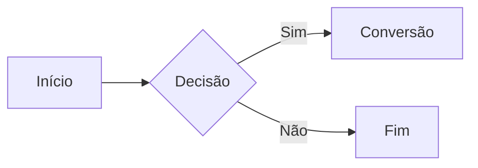
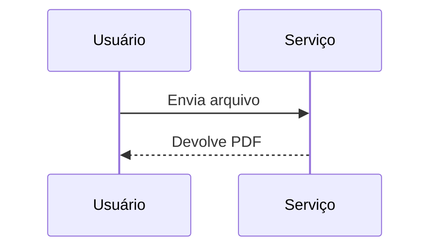
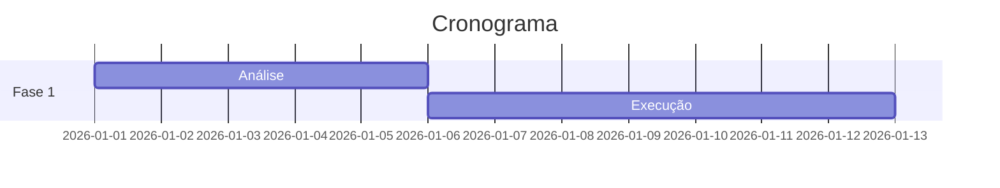

# Visão geral

Parágrafo com **negrito**, *itálico*, ~~tachado~~ e `codigo_inline`. Acentuação: ação, coração,
informação, pé, avô e Ünïcódé. Emoji: :rocket:

Uma frase com nota de rodapé[^nota].

## Lista aninhada

- Nível um
  - Nível dois
    - Nível três
      1. Ordenado no quarto nível
- Item com bloco de código:

  ```python
  def calcular_total(itens):
      return sum(itens)
  ```

## Tarefas

- [x] Tarefa concluída
- [ ] Tarefa pendente

## Tabelas

| Coluna | Código  | Observação         |
|:-------|:-------:|-------------------:|
| Alfa   | `x = 1` | linha 1<br>linha 2 |
| Beta   | `y = 2` | Conversão          |

| Nome | Valor |
|------|------:|
| Gama |  3,14 |

## Código

```javascript
function somarValores(a, b) {
  return a + b;
}
```

## Diagramas







## Matemática

A equação $E = mc^2$ aparece em linha e a soma aparece em destaque:

$$
\sum_{k=1}^{n} k = \frac{n(n+1)}{2}
$$

```math
a^2 + b^2 = c^2
```

## Alerta

> [!NOTE]
> Texto do alerta de nota.

## HTML

<details>
<summary>Resumo expansível</summary>

Conteúdo oculto do bloco details.

</details>

Fórmula H<sub>2</sub>O, potência x<sup>2</sup> e tecla <kbd>Ctrl</kbd>.

<!-- segredo-do-comentario -->

## Imagem


[^nota]: Texto da nota de rodapé.
